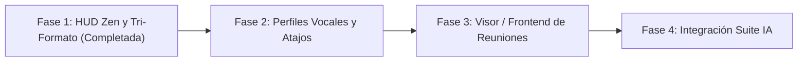

# 📋 Bitácora de Desarrollo y Hoja de Ruta (Roadmap)
## Proyecto: Asistente de Reunión Local (100% Offline y Privado)

Esta bitácora documenta el diagnóstico de arquitectura, deudas técnicas resueltas y pendientes, el roadmap de evolución y el registro histórico de versiones del Asistente de Reunión.

---

## 🧭 1. Visión y Diagnóstico de Arquitectura (v1.1.0)

El proyecto es un asistente de reuniones de escritorio para Windows diseñado para operar de forma 100% local, privada y confidencial. Captura simultáneamente el audio del sistema (reuniones remotas en Teams, Meet, Zoom) y el micrófono local, identifica interlocutores por diarización acústica en CPU, transcribe mediante Whisper cuantizado (INT8), graba el audio en streaming continuo a `.wav` sin impacto en RAM y genera actas estructuradas en Markdown (`.md`) y JSON sincronizado (`.json`).

### Fortalezas Clave
- **Captura Dual Simultánea (WASAPI Loopback + Micrófono):** No requiere cables virtuales ni software de terceros; captura directamente altavoces y micrófono.
- **Cero Fuga a la Nube (100% Privado):** Todo el cómputo de voz a texto y generación de minutas corre localmente en el equipo.
- **Modo HUD Zen Minimalista:** Cápsula flotante ultra-compacta (52 px) con onda reactiva de 5 barras que pulsa al ritmo del volumen de voz, eliminando distracciones visuales.
- **Sincronización Milimétrica Audio-Texto:** El conteo exacto de muestras del grabador WAV permite enlazar cada segmento de transcripción con los segundos reales del archivo de audio.
- **Ecosistema Tri-Formato Preparado para Frontend:** Genera `.wav` (audio raw), `.md` (minuta estructurada con Frontmatter YAML y tareas interactivas) y `.json` (timeline para reproductores con click-to-seek interactivo).

---

## 🔍 2. Deudas Técnicas y Oportunidades de Mejora

| ID | Área | Descripción de la Oportunidad / Deuda | Estado / Prioridad |
|---|---|---|---|
| **DT-AR01** | **Rendimiento** | Scroll continuo de transcripción saturaba la GPU/CPU y distraía en reuniones. | **RESUELTO (v1.1.0 HUD Zen)** |
| **DT-AR02** | **Almacenamiento** | Solo se guardaba texto plano `.txt`; no había archivo de audio ni marcas de tiempo relativas. | **RESUELTO (v1.1.0 WAV + MD + JSON)** |
| **DT-AR03** | **Robustez Arranque** | Fallo por import de typing `Any` en `audio_mixer_capture.py`. | **RESUELTO (v1.1.0)** |
| **DT-AR04** | **Diarización Dinámica** | La diarización actual diferencia entre Tú (mic) y Colegas (loopback con clustering acústico). Podría enriquecerse con perfiles de voz precargados de compañeros recurrentes. | **Media** |
| **DT-AR05** | **Compresión Opcional** | Los archivos `.wav` son PCM 16kHz (~1.9 MB/minuto). Evaluar compresión local a `.opus` o `.flac` al finalizar la reunión si el usuario desea ahorrar espacio. | **Media** |
| **DT-AR06** | **Atajos Globales (Mute)** | Botón de silencio rápido o atajo global de teclado para pausar temporalmente la captura/grabación. | **Alta** |

---

## 🗺️ 3. Plan de Trabajo y Fases de Evolución

### 🔹 Fase 1: HUD Zen, Grabación WAV y Tri-Formato Sincronizado (Completada - v1.1.0)
- [x] Rediseño de interfaz a cápsula minimalista HUD Zen (52 px de altura).
- [x] Widget de onda reactiva animada en tiempo real según el volumen RMS capturado.
- [x] Ocultación del scroll continuo de texto, accesible bajo demanda con `[📜 Texto ▾/▴]`.
- [x] Módulo `AudioMeetingRecorder` para streaming directo a `.wav` (16 kHz mono) con 0 RAM retenida.
- [x] Módulo `TranscriptManager` para generación sincronizada tri-formato (`.wav`, `.md`, `.json`, `.txt`).
- [x] Inclusión de Frontmatter YAML, tablas de decisiones y checklists interactivos (`- [ ]`) en el `.md`.
- [x] Generación de timeline `.json` estructurado para click-to-seek en frontend interactivo.
- [x] Suite de pruebas automatizadas y repositorio Git inicializado.

### 🔹 Fase 2: Atajos Globales y Enriquecimiento de Diarización
- [ ] Atajo global de teclado (ej. `Ctrl+Shift+M`) para Pausar / Reanudar la captura de audio en cualquier momento.
- [ ] Soporte para bautizar a los participantes durante o al final de la reunión (ej: renombrar `Participante 1` a `Carlos`).
- [ ] Selector de micrófono / dispositivo de salida directo desde el menú de opciones sin editar `config.json`.

### 🔹 Fase 3: Visor / Intérprete Interactivo de Grabaciones
- [ ] Desarrollo de una aplicación frontend (web local o desktop) compartida por la suite:
  - Explorador de sesiones de reuniones anteriores.
  - Reproductor con visualizador de ondas (Wavesurfer.js) sincronizado con el `.json`.
  - Clic en cualquier párrafo de la transcripción para reproducir el audio en ese segundo exacto.
  - Gestión interactiva de compromisos pendientes (marcar tareas como completadas).
  - Exportación de minutas a PDF / Word / Correo electrónico corporativo.

### 🔹 Fase 4: Ecosistema Unificado de Productividad
- [ ] Replicar el formato tri-formato en `09_TraductorAudio` (subtítulos y traducciones sincronizadas con audio).
- [ ] Integración profunda con el lanzador `12_Lanzador-Apps-IA` para monitorizar estado, duración y grabaciones recientes desde el panel flotante.

---

## 📝 4. Registro Histórico de Cambios (Changelog)

Formato basado en [Keep a Changelog](https://keepachangelog.com/es-ES/1.0.0/) y versionado semántico.

### [1.2.0] - 2026-11-20
#### Diagnóstico de Sesiones Reales Nocturnas (00:34–01:35 a.m.)
Del análisis de `asistente_reunion.log`, `reunion_20261120_013023.md`/`.wav` (vídeo técnico YouTube sobre Espressif ESP-Mosaico/ESP32/ESP8266) y `reunion_20261120_003428.wav` (micrófono bajo volumen) en `Intel Core i7-6500U`:
1. **Bloqueo de cola con modelo `small`:** Tardaba `12.9s–13.3s` por cada bloque de `5.3s` (`RTF = 2.45x`), acumulando retraso y perdiendo fluidez en tiempo real. Al cambiar a `tiny` (`RTF = 0.34x`), la precisión fonética en español resultó insuficiente.
2. **Saturación de Silero VAD por pre-amplificación (`10x`):** Amplificar bloques de 100ms hasta `10x` antes del VAD elevaba música/respiración sobre el umbral `0.35`, forzando cortes rígidos por `max_speech`.
3. **Palabras divididas en frontera de bloque (`"dispuesto | positivo"`):** Cortar exactamente al alcanzar `max_speech` truncaba sílabas intermedias.
4. **Doble filtrado VAD y eco de prompt:** Ejecutar `vad_filter=True` dentro de Whisper consumía ~35% extra de CPU; además, un `initial_prompt` redactado como lista suelta de acrónimos provocaba eco al inicio con música.
5. **Alternancia falsa en diarización (`Participante 1` ↔ `Participante 2`):** Picos aislados de F0 hacían caer la similitud coseno por debajo de `0.40`, rompiendo la histeresis para un solo locutor continuo.
6. **Bug temporal en modo `mixed` y errores LLM/Agente:** Resuelta la deriva temporal 2x en WAV mixto (`_flush_mixed_recorder`), aislamiento de buffers `mic`/`pc`, `ReadTimeoutError` de Ollama migrando a `stream=True` + `num_ctx=2048` + `qwen2.5:3b` y normalización de `decisions` en `_normalize_llm_report()`.

#### Tabla Comparativa de Experimentos y Cambios Aplicados
| Experimento / Decisión | Resultado Observado | Estado Final |
|---|---|---|
| `small` + `vad_filter=True` (CPU `i7-6500U`) | `12.9s` por cada `5.3s` (`RTF = 2.45x`), saturaba cola | **Descartado por defecto** (conservado como opción en menú) |
| `tiny` (`39M`) | Rápido (`RTF = 0.34x`), errores fonéticos altos en ES | **Descartado por defecto** |
| **`base` (`74M`) + `cpu_threads=4` + `beam=2` + `vad_filter=False`** | **`RTF = 0.42x–0.52x`** (casi 2x más rápido que tiempo real) | **Adoptado por defecto (`config.json`, `main.py`, `theme_config.py`)** |
| Corte rígido en `max_speech` vs **Multi-Scale Valley Splitting (`130ms + 240ms`)** | El corte rígido partía palabras; Valley Splitting corta en el valle inter-palabra conservando `carry_over` | **Adoptado (`_find_best_valley_cut`)** |
| Ganancia VAD `10x` (umbral `0.35`) vs **Ganancia VAD `<= 3.5x` (umbral `0.42`)** | Evita falsos positivos por música de fondo sin perder voz baja en micrófono | **Adoptado (`_get_neural_speech_prob`)** |
| `initial_prompt` lista de siglas vs **Oración natural + `_refine_technical_text()`** | Elimina eco inicial de acrónimos y normaliza `Espressif`, `ESP-Mosaico`, `microcontroladores` | **Adoptado (`meeting_transcriber.py`)** |
| Diarización remota con salto directo `< 0.40` vs **Histeresis estricta (`streak >= 2`, `pause >= 0.65s`, `sim < 0.58`)** | 15/15 segmentos estables en `Participante 1` para un narrador continuo (conservando multi-locutor en mic) | **Adoptado (`speaker_diarizer.py`)** |
| Ollama síncrono `num_ctx=4096` vs **Streaming JSON (`qwen2.5:3b`, `num_ctx=2048`)** | Elimina timeouts al generar minuta ejecutiva local | **Adoptado (`meeting_agent.py`)** |

#### Añadido en Calidad y Pruebas (`test_real_audio_functional.py`)
- **Suite funcional con audios reales (`test_real_audio_functional.py`):**
  1. Validación sobre `reunion_20261120_013023.wav` (YouTube real, 65s): procesado en `33.62s` (`RTF = 0.52x`), `15/15` segmentos asignados a `Participante 1`, `4/5` términos clave técnicos verificados y exportación `.md`/`.json`/`.txt`.
  2. Validación sobre `reunion_20261120_003428.wav` (micrófono bajo volumen, 60s): `RTF = 0.12x`, recuperación limpia por `AGC` bajo etiqueta `Tú`.
  3. Prueba en vivo extremo a extremo reproduciendo síntesis `SAPI5` por altavoces con captura real **WASAPI Loopback** (`AudioMixerCaptureManager`).
- Método `flush_and_stop()` en `LiveMeetingTranscriber` para drenado determinista al cerrar sesión sin perder la frase final.

### [1.1.0] - 2026-11-19
#### Añadido
- **Modo HUD Zen Minimalista:** Ventana compacta estilo cápsula flotante (52 px de altura) con esquinas redondeadas y translucidez.
- **Onda Reactiva Animada (`AudioWavePulseWidget`):** 5 barras que modulan su altura y color dinámicamente según la intensidad de la voz (cian en reposo, esmeralda activo).
- **Grabación Streaming a `.wav`:** Grabador maestro `AudioMeetingRecorder` que vuelca el audio en bloques continuos a disco en 16 kHz mono PCM, garantizando 0 MB de consumo de RAM acumulativo.
- **Formato Dual Estructurado (`.md` + `.json`):**
  - **Markdown (`.md`)**: Frontmatter YAML con metadatos de sesión, marcas de tiempo relativas al audio `[MM:SS ➔ MM:SS]` y minuta con tablas GFM y tareas interactivas (`- [ ]`).
  - **Timeline JSON (`.json`)**: Array de segmentos temporales `{start_sec, end_sec, time_range, speaker, text}` preparado para integración con reproductores web interactivos.
- **Transcriptor con Marcas Temporales Relativas:** `LiveMeetingTranscriber` calcula el offset en segundos desde el inicio de la grabación para cada intervención.
- **Suite de Pruebas Automatizadas:** Creación de `test_audio_and_markdown_sync.py` validando grabación WAV, dualidad MD/JSON y funcionalidad del HUD Zen.
- **Repositorio Git y Versionado:** Inicialización de Git en la rama `main` con `.gitignore` exhaustivo.

#### Corregido
- **Importación de Tipos en Captura:** Corrección de `NameError: name 'Any' is not defined` en `audio_mixer_capture.py` que impedía el arranque en modo silencioso.
- **Sobrecarga de Renderizado:** Eliminada la renderización continua de texto en primer plano, optimizando el uso de CPU/GPU.

### [1.0.0] - 2026-11-18
#### Añadido
- Versión inicial del Asistente de Reunión Local 100% Offline.
- Captura dual WASAPI Loopback (PC) y Micrófono.
- Diarización acústica básica en CPU para participantes remotos.
- Transcripción Whisper INT8 multilingüe (Español / Inglés).
- Agente heurístico y conector con Ollama para resumen de minutas y compromisos.
- Almacenamiento en archivos de texto plano `.txt`.
- Control de instancia única por sockets locales `QLocalServer`.
