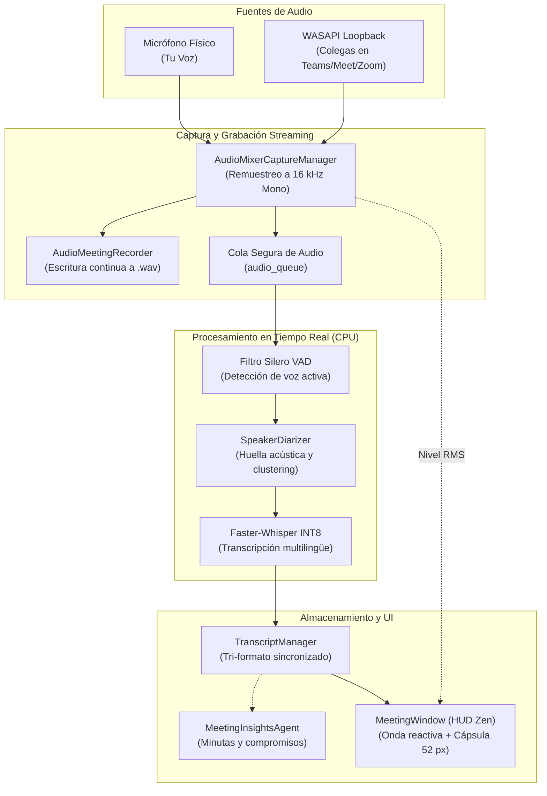

# 🏗️ 01. Arquitectura y Flujo de Procesamiento

Este documento describe la arquitectura modular del **Asistente de Reunión Local** y el flujo que sigue una señal de audio desde que entra por el hardware hasta que se guarda sincronizada en disco.

---

## 🧭 Diagrama de Flujo General

---

## 🧩 Componentes Modulares

### 1. `AudioMixerCaptureManager` (`audio_mixer_capture.py`)
- Gestiona streams de audio con `pyaudiowpatch`.
- Abre simultáneamente un stream WASAPI Loopback para la salida predeterminada de audio y un stream para el micrófono de entrada.
- Aplica remuestreo de alta calidad (`scipy.signal.resample_poly`) desde la frecuencia nativa del dispositivo (típicamente 44.1 kHz o 48 kHz) a **16.000 Hz Mono**, estándar de Whisper.
- Calcula el valor RMS en vivo para alimentar la onda de audio visual.
- Transfiere cada bloque capturado al grabador maestro `AudioMeetingRecorder` sin bloquear la cola de inferencia.

### 2. `AudioMeetingRecorder` (`audio_recorder.py`)
- Escribe bloques de audio PCM crudo directamente al archivo `.wav` abierto en disco con `wave.open(..., 'wb')`.
- No retiene arrays en memoria RAM.
- Lleva la cuenta exacta de frames (`total_frames_written`) y tiempo acumulado en segundos (`current_seconds`).
- Al finalizar, sella los encabezados WAV con la duración y tamaño exactos.

### 3. `SpeakerDiarizer` (`speaker_diarizer.py`)
- Clasifica las voces en tiempo real en CPU en menos de 5 milisegundos.
- El canal físico de micrófono se etiqueta automáticamente como `[Tú]`.
- El canal de loopback (remotos) analiza frecuencia fundamental (F0), balance espectral y bancos de filtros para diferenciar entre `[Participante 1]`, `[Participante 2]`, etc.

### 4. `LiveMeetingTranscriber` (`meeting_transcriber.py`)
- Ejecuta Faster-Whisper con cuantización INT8 localmente.
- Silero VAD recorta silencios y ruido ambiente.
- Calcula el inicio y fin relativo de la frase respecto al inicio de la grabación para proveer marcas de tiempo exactas al audio.

### 5. `MeetingInsightsAgent` (`meeting_agent.py`)
- Extrae compromisos y responsables (ej: *"revisar endpoints"* -> `Participante 1`).
- Identifica decisiones técnicas y temas de estudio.
- Admite dos modos: **Motor heurístico local ultra-rápido** y **Ollama local** (`qwen2.5` / `llama3.2`).
